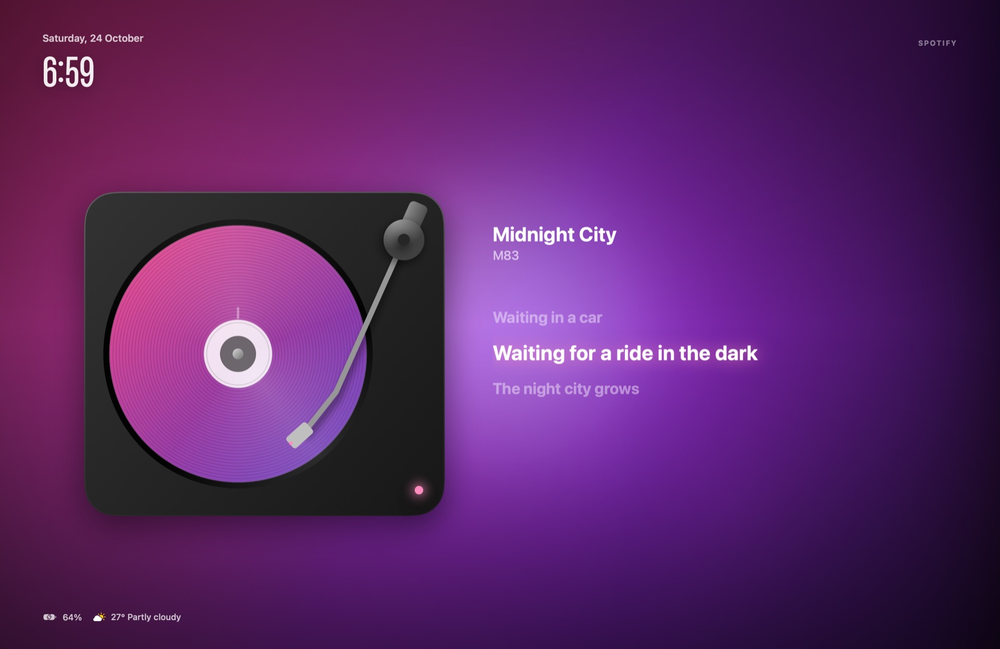
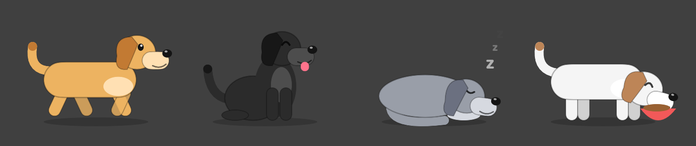

# NotchDeck

A mission control for the MacBook notch, in the spirit of Alcove, NotchNook, boring.notch, MewNotch
and Atoll. Hover (or click, or press ⌥Space) and the notch opens into a themed panel; move away and it
folds back. Displays without a notch get a floating "island" or a virtual notch.



*The lock screen while a song plays: the record is the album art, the lyrics follow the song, and the background is made from the cover's colours.*



*The desktop dog, in its four moods.*

## Download

Get **NotchDeck-<version>.dmg** from the [latest release](https://github.com/tadiPro250/notchdeck/releases/latest),
open it and drag NotchDeck into Applications. Needs macOS 14 or later.

NotchDeck isn't notarized by Apple (that needs a paid Developer ID), so the first launch is blocked.
Allow it once: open it, then go to **System Settings → Privacy & Security** and press **Open Anyway**
(on older macOS, right-click the app → Open). It asks for Accessibility only if you keep the
volume/brightness HUD replacement on; see [Permissions](#permissions).

Updates: NotchDeck checks this repository's releases (Settings → About).

## Tabs

| Tab | What it does |
|---|---|
| **Home** | Now playing from **any app** (Spotify, Music, Safari, Brave/Chrome/YouTube, Podcasts, QuickTime…) with artwork, scrubber, controls, visualiser and **time-synced lyrics**; beside it a widget of your choice: clock with weather and next event, weather, next event, or system stats |
| **Tray** | Drag files onto the notch to stash them; drag out, double-click to open, AirDrop. Optionally keeps its own copy; finished downloads can land here |
| **Calendar** | Today's and tomorrow's events from every calendar in Calendar.app, a week strip with busy days, a **Join** button for Zoom/Meet/Teams/Webex/FaceTime links (green from ten minutes before), and a click opens the event in Calendar |
| **Clock** | Alarms (repeat days, label, snooze), a timer and a stopwatch with laps |
| **Desk** | Notes (auto-saved), To-do from Apple Reminders (tick off, add), your Shortcuts one click away, and a Script widget that runs a shell command on an interval |
| **Clipboard** | Recent copies; click to copy again; **search** and filter by text, links, images or files; **pin** favourites; optionally remembered across restarts, encrypted |
| **Mirror** | The front camera, for a check before calls; off the moment you leave the tab |
| **Controls** | Brightness for the built-in display **and external monitors (DDC)**, keyboard backlight, volume, sound output switcher, mic mute, Keep Awake, Dark Mode, Hide Desktop, Screenshot, Display Off, Sleep, Lock |
| **System** | CPU, GPU, RAM, disk, **the apps using the CPU right now** (click to bring one forward), network up/down, battery health, cycles and capacity, and the batteries of AirPods, mice and keyboards |

Each tab except Home can be switched off in Settings → Modules. Move between tabs with a two-finger
swipe, ← → (when opened by the shortcut), or ⌘1–9. Esc closes.

Videos (Netflix or YouTube in a browser, QuickTime, TV, IINA, VLC…) show on Home with 15-second skip
buttons instead of track buttons, get no lyrics search, and never bring up the record-player lock screen:
that is for songs. A browser tab counts as a song only when it says who the artist and album are (Spotify,
YouTube Music and Apple Music on the web do), or comes from a YouTube "– Topic" channel.

## The dog

It wanders, sniffs about, sits, lies down, scratches, barks when it's hungry, chases your pointer when it's
in a playful mood, turns to look at the pointer when it comes near, and says hello when you unlock the Mac.
From bedtime to wake-up (11 pm to 7 am unless you change it in Settings → Your Dog) it sleeps right through;
pet it and it lifts its head, then settles back down. It wakes with a stretch.

Its clock only runs while the Mac is awake: system sleep, a sleeping display and a shut-down Mac don't
count, so a closed lid never starves it. Care has consequences:

- **Food:** a bowl lasts about ten waking hours. Feed it when it's hungry. Food past full gives it no love,
  puts weight on, and a second helping on a full stomach makes it throw up.
- **Weight:** kept full all day it gets heavier, then overweight (slower, no more chasing), then obese, which
  makes it ill. Underfed it gets thin. Weight comes off slowly with sensible feeding and play.
- **Love:** affection fades over about ten waking hours; click it to pet it (a pat counts for less if you've
  just given ten). A lonely dog droops, lies about, won't play, and in time falls ill.
- **Health:** starving, obesity and loneliness wear it down; good care builds it back up. A sick dog lies
  with a thermometer and needs rest or the **vet** (from its card), who keeps it for twenty minutes and
  sends it home better, with advice.

The notch tells you once when it's hungry, lonely, getting heavy, sick, or back from the vet.

## Around the closed notch

In order of priority:

1. **Ringing**: an alarm or a finished timer, with Snooze and Stop, until you answer it (5 min max).
2. **HUD**: replaces the macOS volume, brightness and keyboard-light pop-ups (wings or a bar).
3. **Drop-down cards**: charging / unplugged / low battery; Bluetooth devices connecting with their
   battery (AirPods: left, right, case); a meeting in five minutes; a reminder coming due; Focus on
   or off; a download finished.
4. **Timer** and **stopwatch** running.
5. **Meeting countdown**: the last ten minutes before an event.
6. **Download progress** from ~/Downloads (Chrome, Brave, Edge, Arc, Safari, Firefox).
7. **Music**: artwork and a visualiser (bars, wave or dots).
8. **Privacy dots**: green camera, orange microphone, purple screen recording, red muted mic.

## Settings

Open from the gear in the panel, the menu bar icon, or ⌘, in its menu. Panes: General (open on hover
or click, hover delay, keyboard shortcut, swipe, haptics, launch at login), Appearance (live preview,
seven themes, accent from album art / theme / custom, corner roundness, shadow, Home widget),
Displays (which screens, island style, lock-screen widget), Modules, Media & HUD (visualiser, lyrics,
HUD style, key step size), Live Activities (each one on or off), Clock (alarm sound, snooze length),
Desk (script command and interval), Tray & Clipboard, Weather (city, units), About (permissions,
update check).

Every theme is pure black at the top edge so the panel stays seamless with the hardware notch.

## Build and run

Needs macOS 14+ and the Swift toolchain (the Command Line Tools are enough; Xcode is not required).

```bash
scripts/make-signing-identity.sh     # once: a local identity so permissions survive rebuilds
scripts/build-app.sh --install       # build, copy to /Applications, launch
swift scripts/make-icon.swift .      # regenerate Resources/AppIcon.icns
scripts/release.sh                   # zip + dmg in build/ (notarizes too, given a Developer ID)
```

Flags for development:

```bash
build/NotchDeck.app/Contents/MacOS/NotchDeck --render-previews previews   # every state to PNG
open /Applications/NotchDeck.app --args --open clock      # open a tab on launch
open /Applications/NotchDeck.app --args --settings        # open Settings on launch
open /Applications/NotchDeck.app --args --onboarding      # show the welcome window
open /Applications/NotchDeck.app --args --test-ring       # ring a sample alarm for 5 s
```

`--render-previews` uses SwiftUI's `ImageRenderer`, which can't draw native controls (text editors,
the camera, menus, the drop target) or scroll views; the real app has neither problem.

**Updates**: put your GitHub repository in Settings → About. Publish `scripts/release.sh`'s zip/dmg as
a release tagged `v<version>`, and NotchDeck will offer it. A signed, notarized release that opens
without a warning on other Macs needs an Apple Developer ID; without one, others open it with
right-click → Open.

## Permissions

| Permission | For | Asked when |
|---|---|---|
| Accessibility | replacing the volume/brightness/keyboard HUD | on launch, if the HUD option is on |
| Automation | Spotify/Music fallback, Dark Mode | first use |
| Calendars / Reminders | Calendar tab, countdowns; Desk → To-do, due alerts | you press Connect |
| Camera | Mirror tab | you open it |
| Bluetooth | device announcements | on launch, if that activity is on |
| Downloads folder | download progress | on launch, if that activity is on |
| Full Disk Access (optional) | knowing which Focus is on | you grant it in System Settings |

Network use: weather (Open-Meteo, the city name), lyrics (LRCLIB, song title and artist), the update
check (GitHub, only if you set a repository). Nothing else leaves the Mac.

## How it works

| Piece | Mechanism |
|---|---|
| Panel | Borderless non-activating `NSPanel` per display, above the menu bar, ignoring the mouse while collapsed |
| Notch size | `NSScreen.safeAreaInsets` plus `auxiliaryTopLeftArea`/`RightArea`; island or virtual notch elsewhere |
| Now playing | `Helpers/MediaRemoteBridge.m`, a dylib loaded into Apple's `/usr/bin/perl` (MediaRemote only answers Apple-signed processes since macOS 15.4); AppleScript for Spotify/Music as fallback |
| Lyrics | LRCLIB `/api/get`, then `/api/search`; LRC parsed locally |
| HUD replacement | a `CGEventTap` on `NX_SYSDEFINED` media keys; handled keys are swallowed |
| Brightness | private `DisplayServices` (built-in); DDC/CI over `IOAVService` I²C (external, Apple silicon) |
| Keyboard light | private CoreBrightness `KeyboardBrightnessClient` |
| Volume, output, mic | CoreAudio |
| Hot key | Carbon `RegisterEventHotKey` (no permission needed) |
| Lock screen | the window is moved into a SkyLight space at absolute level 400 |
| Privacy dots | CoreMediaIO / CoreAudio "running somewhere", SkyLight screen-watcher check |
| Focus | `~/Library/DoNotDisturb/DB/*.json` |
| Downloads | a `DispatchSource` on ~/Downloads plus published `NSProgress` |
| Clipboard at rest | AES-GCM (CryptoKit), key in the login Keychain |
| Accessories | `BatteryPercent` in the I/O Registry; `system_profiler SPBluetoothDataType` for AirPods |

`@State` is not used: on the macOS 27 SDK it is a macro whose plugin ships only with Xcode, so
view-local state lives in a small `ViewState` box (`Sources/NotchDeck/Views/ViewState.swift`).

Private frameworks (DisplayServices, CoreBrightness, SkyLight, MediaRemote, IOAVService) can change in
any macOS update; each feature built on one turns itself off quietly if its symbol goes missing.

## Licence

NotchDeck is open source under the [MIT License](LICENSE): use it, change it and share it, keeping the
copyright notice. Issues and pull requests are welcome.
